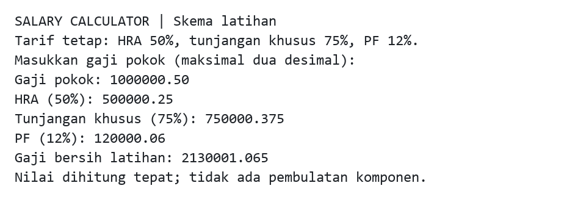

# Salary Calculator Java

Latihan perhitungan gaji terminal Java 17 dengan tarif tetap dari source awal: gaji pokok ditambah HRA 50% dan tunjangan khusus 75%, lalu dikurangi PF 12%. Tarif tersebut merupakan skema latihan tanpa penetapan negara, mata uang, periode, atau aturan payroll tertentu.

## Contoh keluaran terminal



Transkrip hasil eksekusi program yang dirender menjadi gambar. Masukan `1000000.50` menghasilkan HRA `500000.25`, tunjangan khusus `750000.375`, PF `120000.06`, dan hasil bersih latihan `2130001.065`. Gambar memuat stdout program tanpa menampilkan ulang masukan stdin.

## Build dan jalankan

Siapkan JDK 17 dan Maven 3.9 atau lebih baru:

```sh
git clone https://github.com/zalamanga/salary-calculator-java.git
cd salary-calculator-java
mvn verify
java -jar target/salary-calculator-java.jar
```

Perintah berlaku di PowerShell, Linux, dan macOS. Maven mengunduh plugin serta JUnit pada build pertama. JAR hanya memerlukan JDK, tanpa database atau dependency runtime tambahan. IDE Maven dapat membuka `pom.xml`.

## Masukan dan ketepatan desimal

- Masukkan satu angka nonnegatif, maksimal 18 digit bulat dan dua angka desimal dengan titik. Contoh: `1000000`, `1000000.50`, atau `0`.
- Nilai terbesar yang diterima terminal adalah `999999999999999999.99`.
- Koma, pemisah ribuan, tanda `+`, nilai negatif, notasi ilmiah, dan lebih dari dua angka desimal ditolak. Spasi di awal/akhir diabaikan.
- Input tidak valid meminta ulang. Akhir masukan (EOF) menghentikan program tanpa hasil yang belum dihitung.
- Program selesai setelah satu laporan berhasil ditampilkan.

Perhitungan memakai `BigDecimal` tanpa pembulatan komponen atau hasil akhir. Tampilan mempertahankan semua angka desimal yang diperlukan, minimal dua dan maksimal empat untuk masukan terminal. Misalnya gaji pokok `0.01` menghasilkan HRA `0.005`, tunjangan `0.0075`, PF `0.0012`, dan hasil bersih `0.0213`. Dengan cara ini jumlah komponen yang ditampilkan tetap sesuai hasil akhirnya.

Rumus latihan adalah `basic + basic × 0.50 + basic × 0.75 - basic × 0.12`, setara `basic × 2.13`. Label PF mempertahankan istilah sumber awal; tidak ada plafon, pengecualian, pajak, atau pembulatan menurut aturan eksternal.

## API dan pengujian

`SalaryCalculator.calculate(BigDecimal)` mengembalikan `SalaryBreakdown` berisi gaji pokok, HRA, tunjangan khusus, PF, dan hasil bersih yang eksak. API menerima nilai desimal nonnegatif dengan presisi lebih tinggi dari batas input terminal; nilai `null` dan negatif ditolak.

```java
SalaryBreakdown result = SalaryCalculator.calculate(new BigDecimal("100"));
result.netPayableSalary(); // 213.00
```

`mvn verify` memeriksa seluruh tarif asal, nilai nol, pecahan kecil tanpa pemotongan integer, nilai besar, format input tidak valid, EOF, dan hasil terminal. Source berada di `src/main/java/calculator/`, tes di `src/test/java/calculator/`.

## Batas dan asal sumber

Ini latihan aritmetika satu masukan. Program tidak menyimpan pegawai atau riwayat, tidak membaca slip gaji, dan tidak menyediakan aturan payroll berdasarkan negara/tahun. Versi awal memakai integer yang memotong pecahan dan dapat overflow pada perkalian; versi ini mempertahankan tarifnya dengan aritmetika desimal.

Lihat [NOTICE.md](NOTICE.md) untuk asal proyek dan status atribusi/lisensi. Folder build `target/` tidak disertakan dalam Git.

## Alur kode

[Diagram alur, tanggung jawab file, dan batas penyimpanan](docs/CODE_FLOW.md).
