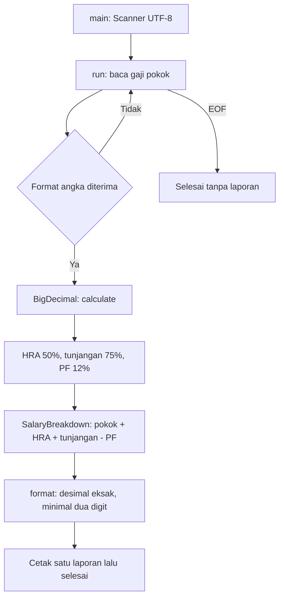

# Alur kode Salary Calculator

Terminal memvalidasi satu gaji pokok. Fungsi `calculate` menerima nilai tersebut dan mengembalikan komponen hasil tanpa melakukan input/output.

Perkalian dan penjumlahan memakai `BigDecimal`; tidak ada pemotongan integer atau pembulatan komponen. Terminal menerima maksimal 18 digit bulat dan dua desimal. API `calculate` menerima presisi desimal lebih luas, tetapi tetap menolak `null` dan nilai negatif.

| Bagian | Sumber |
| --- | --- |
| Input, rumus, dan format hasil | [SalaryCalculator.java](../src/main/java/calculator/SalaryCalculator.java) |
| Nilai hasil | [SalaryBreakdown.java](../src/main/java/calculator/SalaryBreakdown.java) |
| Tarif, pecahan, batas nilai, format buruk, EOF | [SalaryCalculatorTest.java](../src/test/java/calculator/SalaryCalculatorTest.java) |

Tarif berasal dari latihan sumber. Tidak ada mata uang, periode, pajak, atau aturan payroll negara yang ditetapkan oleh program. Tidak ada database atau riwayat laporan. [README](../README.md) menjelaskan cara menjalankan dan contoh angkanya.
